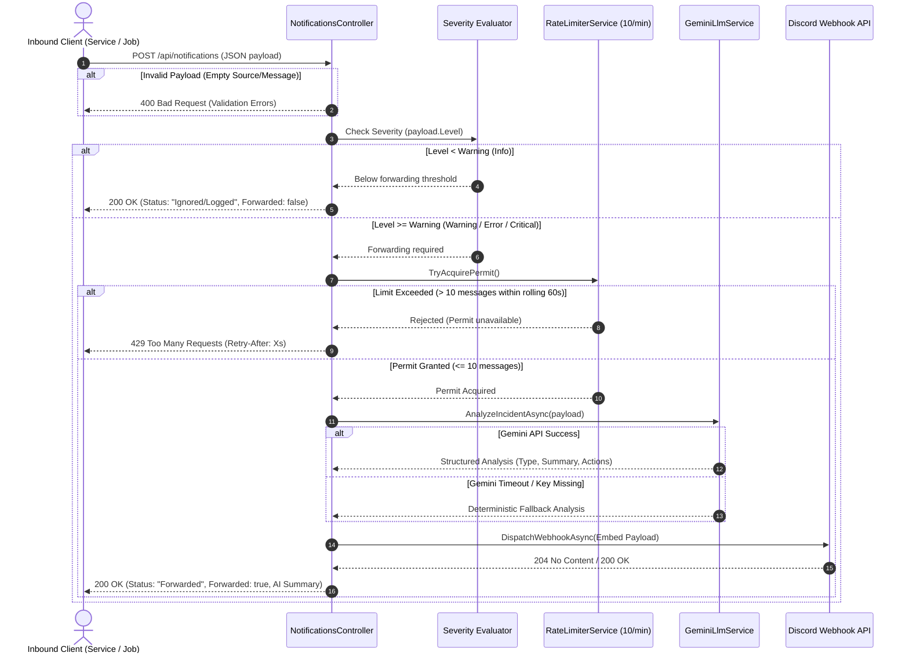
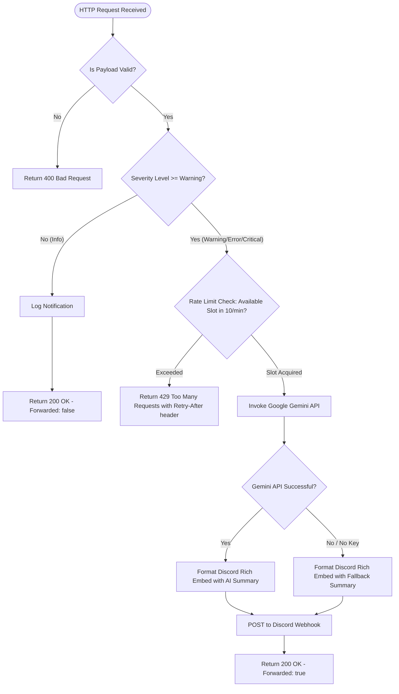

# Request Lifecycle & Flow: NotifyAiPowered

## 1. Overview
This document illustrates the execution lifecycle of incoming notification requests sent to **NotifyAiPowered**, detailing how severity filtering, sliding-window rate limiting, AI enrichment, and external dispatching interact.

---

## 2. Sequence Diagram



---

## 3. Decision & State Flowchart



---

## 4. Detailed Step-by-Step Execution

### Step 1: HTTP Ingestion & Schema Validation
- The endpoint `POST /api/notifications` receives the inbound JSON payload.
- ASP.NET Core model validation verifies required fields:
  - `source`: Non-empty string identifying the origin service.
  - `level`: Valid enum string (`Info`, `Warning`, `Error`, `Critical`).
  - `title`: Non-empty summary headline.
  - `message`: Non-empty descriptive text.
- If invalid, the framework immediately short-circuits with **`400 Bad Request`**.

### Step 2: Severity Level Evaluation
- The severity level is checked against the forwarding threshold:
  $$\text{ShouldForward} = (\text{Level} \ge \text{NotificationLevel.Warning})$$
- **Below Threshold (`Info`):**
  - Notification is logged via `ILogger`.
  - An immediate response is returned:
    ```json
    {
      "status": "Processed",
      "forwarded": false,
      "level": "Info",
      "message": "Notification level is below forwarding threshold (Warning).",
      "timestamp": "2026-11-12T16:30:00Z"
    }
    ```
- **At or Above Threshold (`Warning`, `Error`, `Critical`):**
  - Processing moves to Step 3.

### Step 3: Rolling Window Rate Limiting (10 Messages / Minute)
- A singleton `IRateLimiterService` manages a rolling sliding-window limiter of capacity 10 per 60-second window.
- The service calls `TryAcquire()`.
- **If rate limit is breached:**
  - A `429 Too Many Requests` response is returned.
  - A standard `Retry-After: <seconds>` HTTP header is included.
  - The notification is logged as rate-limited, and outbound network calls (LLM/Discord) are prevented.
- **If permit is acquired:**
  - The counter increments and processing proceeds to Step 4.

### Step 4: AI Incident Enrichment (Google Gemini)
- The request payload is dispatched to `ILlmAnalysisService`.
- A prompt containing the incident context, title, message, source, and metadata is passed to Google Gemini.
- Gemini returns a structured classification:
  - `IncidentType`: e.g. "Database Connection Pool Exhaustion".
  - `Summary`: Concise explanation of what occurred.
  - `ActionRequired`: Suggested immediate remediation.
- **Fault-Tolerant Fallback:** If the Gemini API call times out, returns an error, or no API key is configured, an automated fallback parses the raw message into a standardized format so delivery is guaranteed.

### Step 5: External Channel Dispatch (Discord Webhook)
- `INotificationDispatcher` converts the original request and AI summary into a Discord Webhook Embed.
- Color coding is applied:
  - `Warning`: Orange (`16098851` / `#F59E0B`)
  - `Error`: Red (`15682852` / `#EF4444`)
  - `Critical`: Dark Crimson (`8330525` / `#7F1D1D`)
- Dispatched via an asynchronous `HttpClient` call to the Discord Webhook URL.

### Step 6: Client Response
- The API returns **`200 OK`** (or **`202 Accepted`**) containing:
  - Forwarding confirmation.
  - Classification and summary produced by the AI.
  - Processing timestamp.

